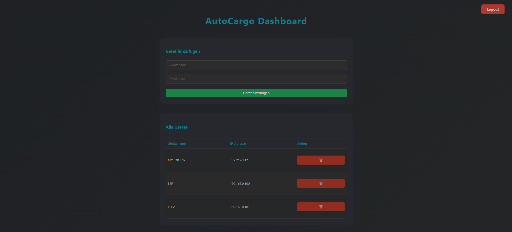
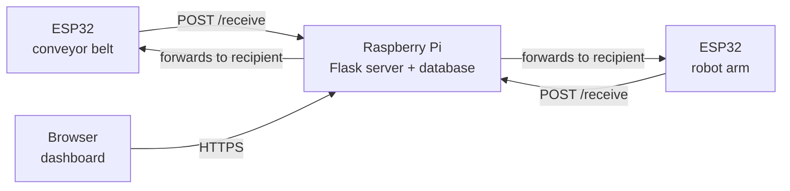
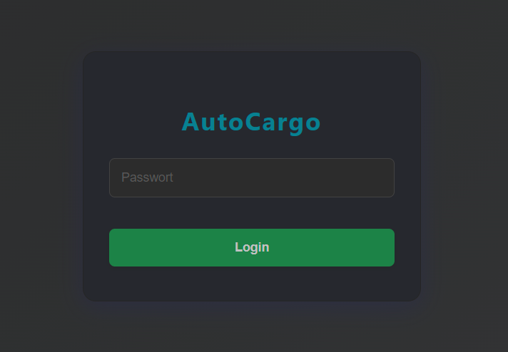
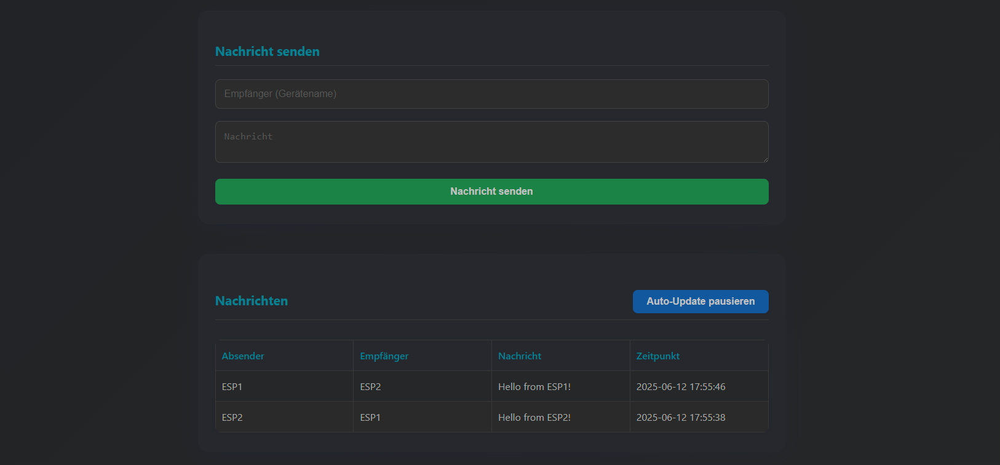

# AutoCargo Engineering

A small message network that lets ESP32 microcontrollers talk to each other through a Raspberry Pi, with a web dashboard to manage the devices and watch the traffic.

It was built for **AutoCargo**, a project by several students of HTL St. Pölten (2nd year, outside of class). The other students used it to let the ESP32s in their machines, such as a **conveyor belt** and a **robot arm**, exchange commands and status messages.



## How it works



- ESP32s never talk to each other directly. Every message goes to the Raspberry Pi, which checks it, stores it and forwards it to the recipient.
- Every ESP32 runs a small web server on port 80 and receives messages on `POST /receive`.
- The dashboard on the Raspberry Pi is protected by a password. In it you can add and remove devices (name + IP address), send messages to a device and see all messages live.
- Messages are deleted when the server restarts; devices are kept.

### Protocol

A message is one line of text, sent as `text/plain`:

```
recipient&sender&password&message
```

Example: `ESP2&ESP1&<shared secret>&Speed: 50`

The server only accepts messages with the correct shared secret. When it forwards a message to the recipient, it replaces the secret with `-`, so it is never sent on to other devices.

## Repository structure

| Folder | Content |
|---|---|
| [`firmware/esp32-node`](firmware/esp32-node) | Current ESP32 firmware (PlatformIO, Arduino framework). Sends and receives messages; WPA2 Personal or WPA2 Enterprise |
| [`firmware/prototype`](firmware/prototype) | First prototype with a JSON-based protocol on port 5000. Not compatible with the current server; kept for reference |
| [`server`](server) | Flask server and dashboard for the Raspberry Pi |
| [`docs/screenshots`](docs/screenshots) | Screenshots of the dashboard |

## Who did what

- **ESP32 firmware and project presentation:** Gabriel
- **Flask server and dashboard:** generated with AI assistance
- **Machines using the network** (conveyor belt, robot arm, …): other students of the AutoCargo project

## Setup

### Server (Raspberry Pi)

Requires Python 3.11+ and MariaDB or MySQL.

```bash
sudo apt install mariadb-server nginx python3-venv
git clone https://github.com/TheGplex/AutoCargo-Engineering.git /opt/autocargo
cd /opt/autocargo/server

# Database: create the schema and a dedicated user (see the end of schema.sql)
sudo mariadb < schema.sql

# Python environment
python3 -m venv .venv
.venv/bin/pip install -r requirements.txt

# Configuration
cp .env.example .env
.venv/bin/python hash_password.py      # paste the output into DASHBOARD_PASSWORD_HASH
nano .env                              # fill in the remaining values
chmod 600 .env
```

Then install the reverse proxy and the service:

- [`deploy/nginx.conf`](server/deploy/nginx.conf): HTTPS for the dashboard, plain HTTP only for `POST /receive` (the ESP32s)
- [`deploy/autocargo.service`](server/deploy/autocargo.service): runs the server with gunicorn as a systemd service

For a quick local test without nginx: set `SESSION_COOKIE_SECURE=false` in `.env` and run `.venv/bin/python app.py` (listens on `127.0.0.1:8000`).

### ESP32 firmware

1. Open `firmware/esp32-node` in PlatformIO.
2. Copy `include/secrets.example.h` to `include/secrets.h` and fill in WiFi, server IP, shared secret and the static IP of this ESP32. `SECRET_SERVER_PASSWORD` must match `DEVICE_SHARED_SECRET` on the server.
3. Set `espName` in `src/main.cpp` (must match the device name in the dashboard) and `USE_WPA2_ENTERPRISE`.
4. Build and upload, then add the device with its name and IP in the dashboard.

`secrets.h` is in `.gitignore` and is never committed.

## Security

What the server does:

- No secrets in the code: all passwords and keys come from `.env` / `secrets.h`, which are not in the repository
- Dashboard password stored only as a hash; login rate-limited (5 attempts per 15 minutes); new session after login; session cookie `HttpOnly`, `Secure`, `SameSite=Lax`, expires after 8 hours
- Every dashboard action requires a login and a CSRF token; logout is a POST request
- Input validation: device names `[A-Za-z0-9_-]{1,32}`, messages max. 500 characters, request bodies max. 4 KB
- Devices can only have private LAN addresses, so the server cannot be abused to send requests to the internet or to itself
- Shared secret compared in constant time and not forwarded to other devices
- Content-Security-Policy without inline scripts, plus `X-Frame-Options`, `nosniff` and `Referrer-Policy`
- Parameterised SQL queries and a database user with only the rights it needs
- Dashboard served over HTTPS through nginx

Known limitations (by design of the firmware protocol):

- The ESP32s send messages over **plain HTTP**, so the shared secret can be read by anyone in the same network. Run the system in a separate, trusted network (for example its own WiFi or VLAN).
- All devices share **one** secret; a single compromised ESP32 can send messages as any device.
- The ESP32 endpoint `POST /receive` does not check who is sending.

A future version could use HTTPS or an HMAC signature per device with a timestamp against replay attacks.

## Screenshots

| Login | Messages |
|---|---|
|  |  |
